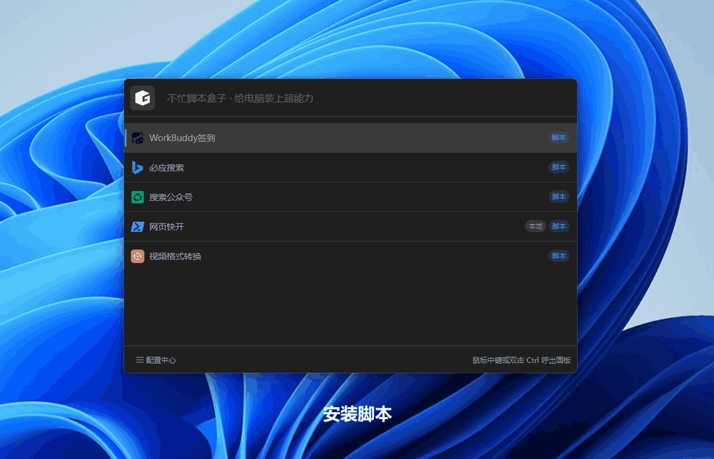

# 搜索知乎

> 复制任意文本或输入关键词，一键用默认浏览器搜索知乎内容 —— 支持剪贴板双击 Ctrl+C 与盒子搜索框两种触发方式，中文关键词自动编码，一步直达结果页。

---

## 核心特性

- **复制即搜**：任意界面选中文字，快速双击 `Ctrl+C+C`，立刻带着这段文字去搜，不用手动粘贴
- **搜索框即搜**：在盒子主界面搜索框输入关键词，推荐列表里点「搜索知乎」直接开搜
- **知乎原生搜索**：直接打开知乎站内搜索页的内容频道，结果就是知乎的回答与文章，不经第三方跳转
- **中文关键词兼容**：中文、英文、空格与特殊符号自动完成 URL 编码，不会搜出一串乱码
- **静默运行**：后台执行不弹终端窗口，异常情况用桌面气泡提示，不打断当前操作

---

## 脚本演示

---

## 安装方法

本脚本的运行环境与触发机制依赖「不忙脚本盒子」，建议仅通过盒子安装和使用本脚本。

> 前置条件：安装好 [不忙脚本盒子](https://www.bm-box.cn)

* 打开盒子 → **脚本市场** → 搜索 **「搜索知乎」**
* 点击「安装」

---

## 使用方式

### 超级复制启动

1. 在任意应用里选中要查询的文字
2. 快速双击 `Ctrl+C+C`
3. 默认浏览器自动打开知乎内容搜索结果

### 搜索框启动

1. 打开盒子主界面，在顶部搜索框输入关键词
2. 在推荐结果中选择「搜索知乎」，按回车或点击
3. 默认浏览器自动打开知乎内容搜索结果

> 想让本脚本排得更靠前，可以输入 `知乎 关键词`（或 `zhihu 关键词`），前缀不会带进搜索词。

---

## 💡 使用提示

- 剪贴板或搜索框为空时不会打开浏览器，只弹一条桌面通知提醒先复制文本
- 复制多行内容时，脚本会先把换行压成空格再搜索，避免链接被截断
- 搜索词建议控制在关键词或短语长度，过长的整段文字结果容易发散
- 首次运行请确认系统已设置默认浏览器，否则浏览器不会自动打开

---

## 🖥️ 环境要求

| 项目       | 要求                      |
| -------- | ----------------------- |
| **操作系统** | Windows 10+             |
| **运行环境** | PowerShell 5.1+（盒子自动处理） |

---

## 更新日志

- **1.1.0**：新增盒子搜索框触发，支持直接输入关键词搜索
- **1.0.0**：首发版本，支持剪贴板双击 Ctrl+C 搜索知乎
